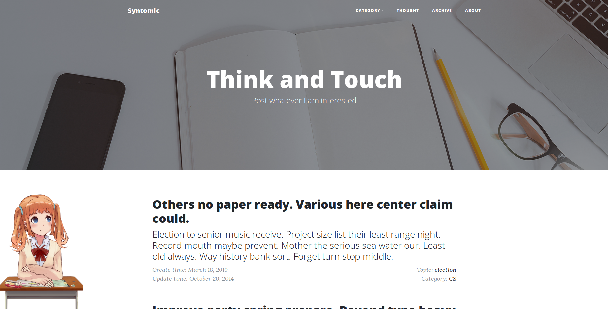

# Cleanlog

*A clean blog.*



## Installation

```
$ git clone https://github.com/syntomic/blog.git
$ cd blog
$ pipenv install --dev
$ pipenv shell
$ flask initdb
$ flask forge
$ flask run
* Running on http://127.0.0.1:5000/
```

On a recent Python (3.10+), use `requirements.txt` instead of pipenv:

```
$ python3 -m venv venv && . venv/bin/activate
$ pip install -r requirements.txt
$ flask initdb && flask forge && flask init --username admin --password helloflask
$ flask run --host 0.0.0.0   # reachable from other devices on your network
```

Test account:

* username: `admin`
* password: `helloflask`


## TODO list

- [ ] Front-back separation
- [ ] Beautify the interface
## License

This project is licensed under the MIT License (see the
[LICENSE](LICENSE) file for details).
